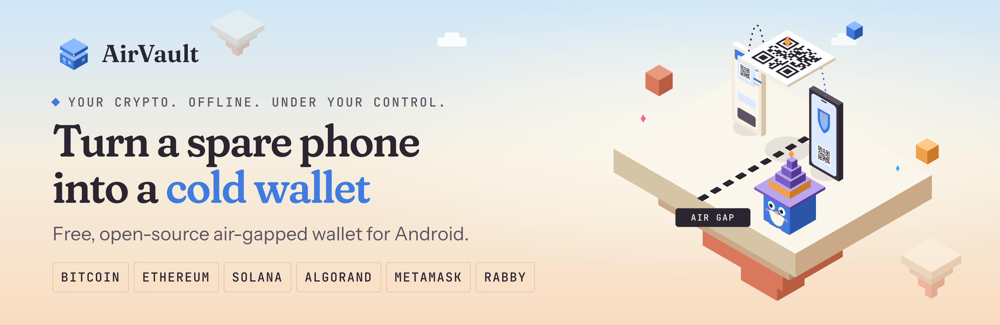

<picture>
  <source media="(prefers-color-scheme: dark)" srcset="docs/brand/readme-banner-dark.png">
  
</picture>

# AirVault: Free Open-Source Air-Gapped Crypto Wallet for Android

**Turn a spare Android phone into an offline cold wallet. Sign by QR code. Keep your keys off the internet.**

[Website](https://alshukran.com/products/airvault) · [Documentation](https://alshukran.com/docs/airvault/) · [Download](https://github.com/al-shukran/airvault/releases) · [Security](SECURITY.md)

[](LICENSE)
[](https://github.com/al-shukran/airvault/releases/latest)
[](https://github.com/al-shukran/airvault/releases)
[](https://kotlinlang.org)

AirVault keeps your private keys on a spare Android phone that never goes online, so remote attacks over the internet cannot reach them. A companion app on your everyday phone prepares and broadcasts transactions, and the two apps talk only through QR codes. It supports Bitcoin, Ethereum and other EVM networks, Solana and Algorand, and works as a QR hardware wallet for MetaMask and Rabby. It is free and open source under Apache-2.0.

> **AirVault has no token and will never ask for your recovery phrase.**
> Read the [full scam warning](#scam-warning) before you act on any message about AirVault.

## Why AirVault

- **Your keys never touch the internet.** Lensly requests no network permission, and the release build fails if its APK requests one.
- **Free and open source.** Use a phone you already own. The code is Apache-2.0 licensed.
- **One vault, many chains.** Bitcoin, Ethereum and other EVM networks, Solana and Algorand each have a chain app.
- **Works with the tools you use.** Pair it with MetaMask or Rabby, and move wallets to or from a Ledger with a 24-word recovery phrase.

## How It Works

AirVault is two Android apps built from one code base.

- **Lensly** is the offline vault and signer. It holds the seed, parses requests, shows the review, and signs. It runs on a phone that never connects to a network.
- **Lumio** is the online companion wallet. It tracks accounts and balances, builds transactions, and broadcasts them. It never sees a private key.

Each signature makes a round trip of QR codes:

1. Lumio builds a transaction and shows it as QR codes.
2. Lensly scans the codes, shows the review, and signs once you approve.
3. Lensly shows the signed result as QR codes.
4. Lumio scans the result and broadcasts it to the network.

Lumio reads balances and prices from free public servers, and it thanks the people who run them. The [chain app table](docs/creating-airvault-apps.md#111-how-each-chain-maps-onto-the-spec) lists the providers it asks. Those servers see the addresses Lumio checks and your IP address. [Limits and distribution](docs/limits-and-distribution.md) lists what else leaks.

## Supported Chains and Wallets

| Chain | Derivation path (N is the account number) | Notes |
|---|---|---|
| Bitcoin | `m/84'/0'/N'` (native segwit). Taproot is `m/86'/0'/N'`, nested segwit `m/49'/0'/N'`, and legacy `m/44'/0'/N'`. | Receive addresses use `/0/i` and change addresses use `/1/i`, where `i` is the address index. |
| Ethereum and EVM networks | `m/44'/60'/N'/0/0` | Matches Ledger Live. Works with MetaMask and Rabby. |
| Solana | `m/44'/501'/N'` | Matches Ledger Live. |
| Algorand | `m/44'/283'/N'/0/0` | Matches the Ledger Algorand app. Other wallets that use the xHD standard show different addresses. |

## Use AirVault as a QR Hardware Wallet with MetaMask and Rabby

Lensly can act as a QR hardware wallet for Ethereum accounts in MetaMask and Rabby. It exports your accounts on the Ledger Live layout in a pairing code, so both wallets show the same addresses that Lensly shows. Each transaction then follows the same round trip as above: the wallet shows a QR code, Lensly reviews and signs it, and the signature goes back as a QR code.

Pairing steps are in the [documentation](https://alshukran.com/docs/airvault/).

## Recover with a Ledger

A Lensly wallet and a Ledger use the same 24-word recovery phrase, so you can move a wallet in either direction. Lensly accepts only 24-word phrases. A 12- or 15-word Ledger phrase cannot be imported. If you set a passphrase, enter the same one on the other device. A lost passphrase cannot be recovered. Follow the [Ledger recovery guide](docs/recover-with-ledger.md) for the steps.

## Install

Lensly and Lumio are published on [GitHub Releases](https://github.com/al-shukran/airvault/releases), with one tag per app (`lensly-v*` and `lumio-v*`). Each release includes an APK and a `SHA256SUMS` file.

Lensly is not on Google Play, and it has no update check. Install it only from a release you have verified, or build it from source.

1. Download the APK and `SHA256SUMS` for the app from its release page, on an online computer.
2. Check the hash from the folder that holds both files:

   ```bash
   shasum -a 256 -c SHA256SUMS   # macOS
   sha256sum -c SHA256SUMS       # Linux
   ```

3. Check the signing certificate with `apksigner verify --print-certs <apk>` from the Android SDK build-tools. Compare its SHA-256 digest with the one in the release notes.
4. Install Lensly on the offline phone with `adb install -r <apk>` over USB, or copy the APK and install it normally.

A matching hash shows only that the file matches its release page. To confirm the same signing key, compare the certificate digest with one from an earlier release you installed. Android installs an update only if it has the same signing certificate, and `adb install -r` keeps the app's data.

Lumio runs on the online phone and can also be tracked with Obtainium. You check each update yourself. Never install an update checker on the Lensly phone. The [distribution notes](docs/limits-and-distribution.md#installing-and-updating) cover this in full.

## Is AirVault Right for You?

For most people, a hardware wallet is safer and simpler. AirVault is a poor fit if you:

- cannot check an APK yourself. Lensly is sideloaded only, and nothing checks the file for you.
- have only one phone. Lensly must stay on a phone that never connects to a network, and Lumio needs a connected phone.
- cannot keep the Lensly phone offline all the time, for example because you need it for messages, banking or two-factor codes.
- may need help recovering a wallet.
- face a capable adversary with physical access or forensic tools. This repository records no independent audit.

**The app cannot bring back an erased vault.** Lensly erases the vault when it cannot verify the vault's state, for example after a storage or Keystore fault or a power cut. It does this before it checks your password. It also erases the vault after the number of wrong passwords you chose. Keep a separate recovery phrase for every wallet. Erasing a vault does not uninstall the app or remove every trace that the phone held one. [Limits and distribution](docs/limits-and-distribution.md) lists what survives an erase.

## Scam Warning

> **AirVault does not have, and never intends to launch, any cryptocurrency, token, coin, airdrop, ICO or presale.**

> Anyone who contacts you on behalf of AirVault, Lensly, Lumio or [alshukran.com](https://alshukran.com) is a scammer, 100%. This is especially true for anyone who asks for a seed phrase or recovery phrase, a private key, a password, or any kind of payment. Never share these with anyone.

## The Names

AirVault is the air gap plus a vault. It is the project and system name, and it is never an app on the phone.

Lensly is the AirVault vault. It sees the outside world only through a lens, by scanning QR codes, and never through a network. It holds the keys and signs.

Lumio comes from *lumen*, the Latin word for light. It is the online side of AirVault. It shows accounts and balances, and it carries signed results out to the network. It never sees a private key.

## Documentation

- [Contributing](CONTRIBUTING.md): CLA, changelog fragments, pull request labels, the CI gate, and local checks.
- [Lensly changelog](CHANGELOG-lensly.md) and [Lumio changelog](CHANGELOG-lumio.md): what changed in each app.
- [Creating AirVault chain apps](docs/creating-airvault-apps.md): how a blockchain becomes a chain app.
- [Recover your wallet with a Ledger](docs/recover-with-ledger.md): move a wallet to a Ledger and back.
- [Limits and distribution](docs/limits-and-distribution.md): who AirVault is a poor fit for, what an erase leaves behind, and how a release is installed and verified.
- [Testing](docs/testing/README.md): test layers, CI design, and local commands.
- [Accessibility](docs/accessibility.md): accepted screen-reader decisions, so audits do not re-raise them.

## Build and Test

You need a JDK and the Android SDK.

```bash
# Debug builds
./gradlew :app:assembleDebug       # Lensly
./gradlew :lumio:assembleDebug     # Lumio

# Unit tests
./gradlew :shared:testDebugUnitTest
./gradlew :app:testDebugUnitTest
./gradlew :lumio:testDebugUnitTest
```

To run one CI partition locally, use `scripts/ci/run-partition.sh <partition>`. See [docs/testing/README.md](docs/testing/README.md) for the partition names.

## Repository Layout

Both apps come from one code base.

| Path | Contents |
|---|---|
| `app/` | Lensly, the offline vault and signer. |
| `lumio/` | Lumio, the online companion wallet. |
| `shared/` | Code both apps use: crypto, UR/QR transport, the parser sandbox, and the address book. |
| `core/` | Chain-neutral interfaces (`model`, `signer-api`, `wallet-api`) and the `conformance` test kit. |
| `chains/` | One chain app per family: `algorand`, `bitcoin`, `evm`, `solana`. `_template` is a stub to copy when a new chain is added. |
| `abi/` | ABI decoder, a pure JVM module. |
| `benchmark/` | Macrobenchmark module that measures the installed app from outside. |
| `tools/` | Helper tools for the screen gallery, icons, registry data, and registry packages. |
| `docs/` | Chain app guide, Ledger recovery guide, and testing docs. |
| `scripts/` | CI and helper scripts. |
| `gradle/` | Gradle wrapper and version catalog (`libs.versions.toml`). |
| `licenses/` | Font licenses and third-party notices. |
| `.github/workflows/` | CI workflows. |

## Contributing

Read [CONTRIBUTING.md](CONTRIBUTING.md) before you open a pull request. It covers the CLA, changelog fragments, pull request labels, the CI gate, and local checks.

## License

Apache License 2.0. See [LICENSE](LICENSE).

AirVault is created by [alshukran.com](https://alshukran.com).
